# DrinksLab

## Índice
- [Introducción](#drinkslab)
- [Características Principales](#características-principales)
- [Tecnologías utilizadas](#tecnologías-utilizadas)
- [Instalación y ejecución](#instalación-y-ejecución)
- [Estado del proyecto](#estado-del-proyecto)
- [Funcionalidades (Pantallas)](#funcionalidades-pantallas)

## Introducción
DrinksLab es un sistema de Punto de Venta local diseñado para la gestión rápida de ventas, control de inventario y administración de proveedores. Está optimizado para terminales físicas con soporte para escáneres de código de barras y atajos de teclado globales.\
El nombre es dado debido a que está hecho a medida para la tienda local con el mismo nombre

## Características Principales
Las caracterísitas principales de DrinksLab están basadas en los objetivos de la aplicación
* **Ventas Fluidas:** Soporte para atajos de teclado (F12, F10, F8, ESC) y captura automática de lectores de código de barras sin necesidad de usar el ratón.
* **Cobro Inteligente:** Cálculo automático de precios por paquete, promociones por volumen y ventas a granel.
* **Inventario Paginado:** Interfaz de búsqueda predictiva (autocompletado) y paginación eficiente para manejar miles de productos sin sobrecargar la memoria.
* **Gestión de Proveedores:** Relación dinámica entre productos y proveedores.
* **Base de Datos Local:** Utiliza H2 Database en un archivo local persistente, no requiere conexión a internet para operar.

## Tecnologías Utilizadas
* **Backend:** Java 25, Spring Boot, Spring Data JPA.
* **Frontend:** JavaFX, FXML, Scene Builder.
* **Base de Datos:** H2 Database (Modo persistente en disco).

## Instalación y Ejecución

### Requisitos previos
* [Java 21 JRE](https://adoptium.net/) instalado en el sistema operativo (Linux, Windows o macOS).

### Instalación
1. Descarga la última versión (`.zip`) desde la pestaña de **Releases** a la derecha de este repositorio.
2. Crea una carpeta en tu computadora donde vivirá el sistema (ej. `DrinksLab`).
3. Descomprime el archivo `.zip` dentro de esa carpeta.
4. Abre una terminal en esa carpeta y ejecuta los siguientes comando:
   ```bash
   chmod +x configurar_lector_linux.sh
   ./configurar_lector_linux.sh
   ```
5. Cierra la sesión y vuelve a entrar
### Ejecución
1. Abre la carpeta en la que descomprimiste el `.zip`
2. Abre una terminal en esa carpeta y ejecuta el siguiente comando:
   ```bash
   java -jar drinkslab-1.0.0.jar
   ```

## Estado del proyecto
Actualmente el proyecto todavía no está terminado, se busca crear nuevas funcionalidades de acuerdo a las necesidades actuales y a las que vayan surgiendo para el negocio que busca apoyar.

## Funcionalidades (Pantallas)
### Ventas
La pantalla principal está dedicada a las ventas:
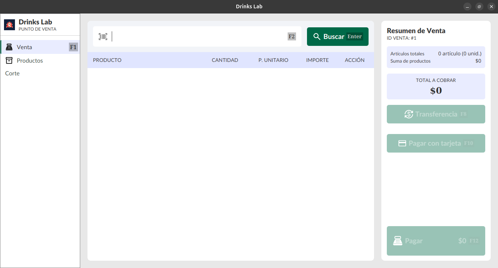
Dentro del texto de búsqueda podemos encontrar un listado de los productos que se tienen guardados.\
Una vez un producto es seleccionado o se escribe su código, el producto es agregado en al sección central
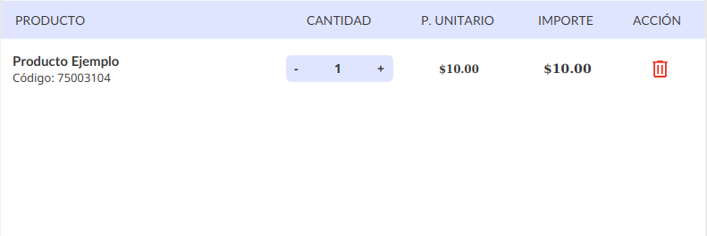
Se puede modificar su cantidad presionando + o -, así como ingresando la cantidad que uno mismo desea.\
Una vez al menos un producto es seleccionado, la pantalla lateral es activada hasta que dejen de existir productos o se finalice la venta.
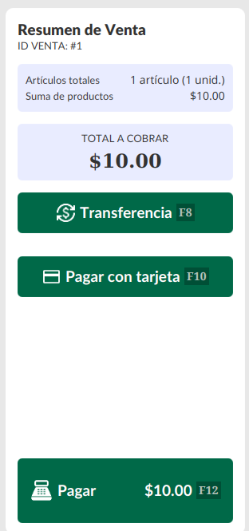
Los botones son habilitados así como sus atajos:
* `F8` para recibir el pago por transferencia
* `F10` para recibir el pago en tarjeta
* `F12` para recibir el pago en Efectivo
### Cobrar
Existen tres tipos distintos de cobro:
* **Transferencia:**
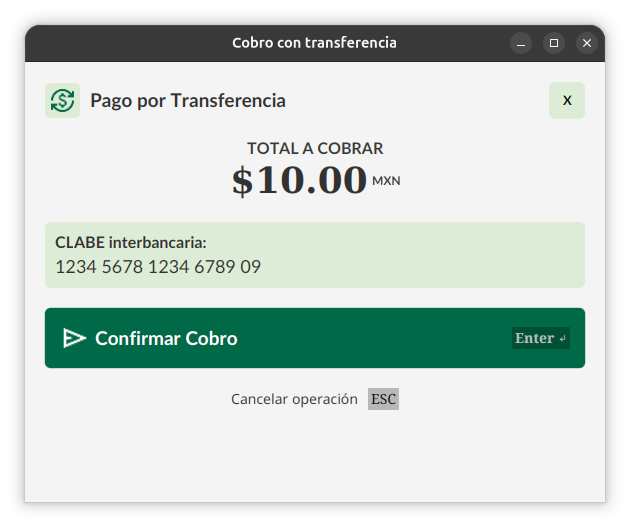
El cobro por transferencia muestra a la clabe para transferencias asignada.\
Para mostrar tu propia CLABE se necesita el archivo `application-local.yaml` en la ruta del jar:
```yaml
tienda:
  cuenta:
    clabe: "TU_CUENTA_CLABE_AQUI"
```
* **Tarjeta:**
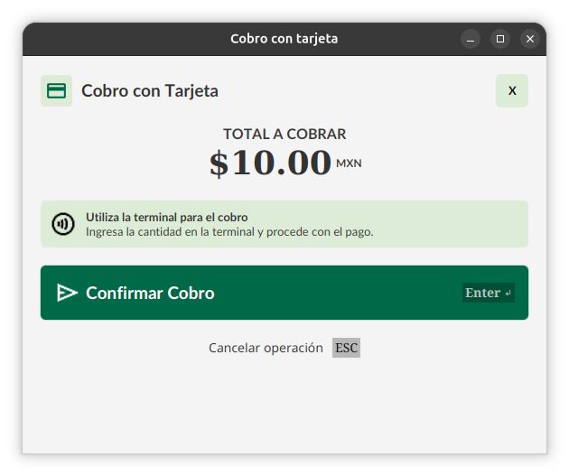
El cobro por tarjeta indica el uso de terminal, sin embargo, el monto guardado en la venta se ve afectado por una comisión del 2.99% + $1
* **Efectivo**
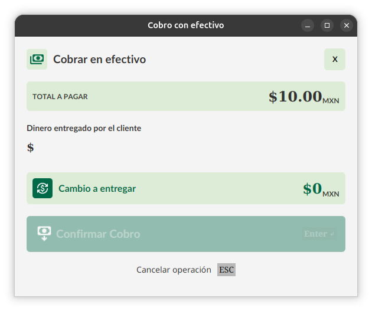
El cobro en efectivo permite ingresar la cantidad de dinero que es dada para poder calcular el cambio que se debe dar.\
Una vez el monto mínimo es dado, se habilita el botón para registrar el pago

### Inventario
La pantalla de inventario permite ver a todos los productos que están registrados.\
Se muestra en bloques 8 y ser permite cambiar de pantalla con botones con el número de la página en la esquina inferior derecha.
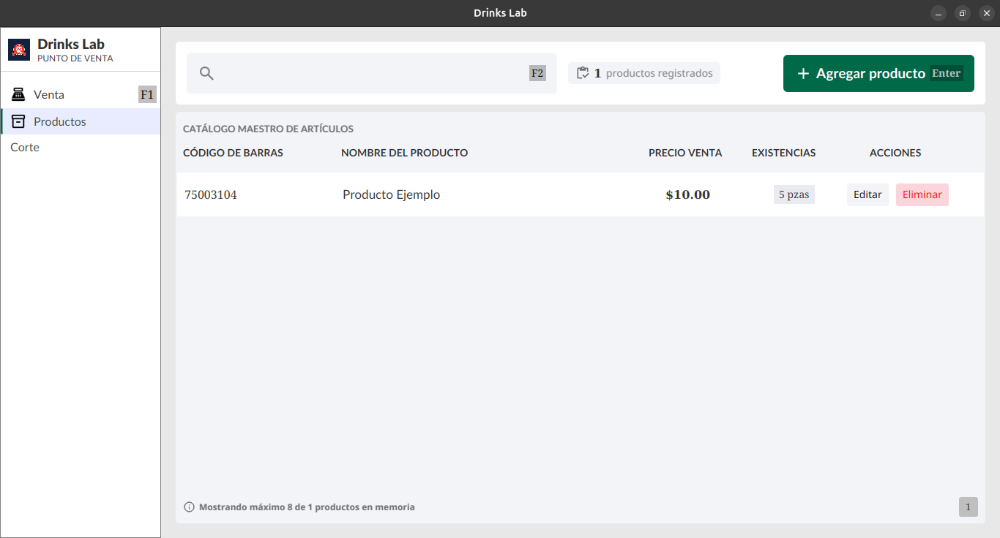
Se puede editar o eliminar a un producto desde ahí.\
La indicación `Existencias` puede cambiar a `Sin info` al tener un inventario negativo en el producto. Indica que el inventario está desactualizado.
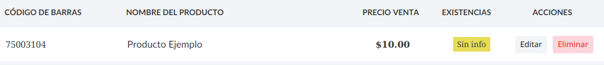

### Gestionar Producto
Es la pantalla encargada de la modificación y creación de un producto. Dentro de ella, también se puede eliminar al producto.
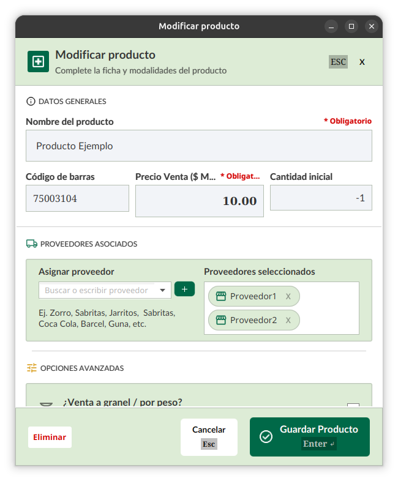
Se puede modificar el nombre, el código, el precio y la cantidad en el inventario.\
Podemos agregar una lista de proveedores asignados al producto, así mismo, el producto puede no tener proveedores.
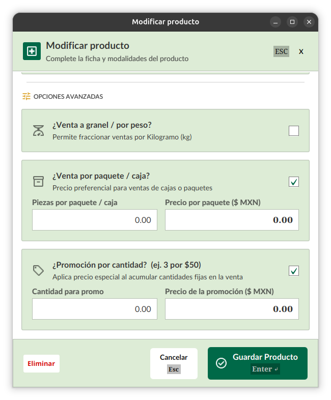
Podemos aplicar precios por paquete o precios por modificación. Al seleccionar cualquiera de los dos, se habilita la entrada para la cantidad y el precio respectivo de cada modo.

### Corte
La pantalla de corte es una pantalla provisional. Permite ver el historial de ventas diarias así como las ganancias.
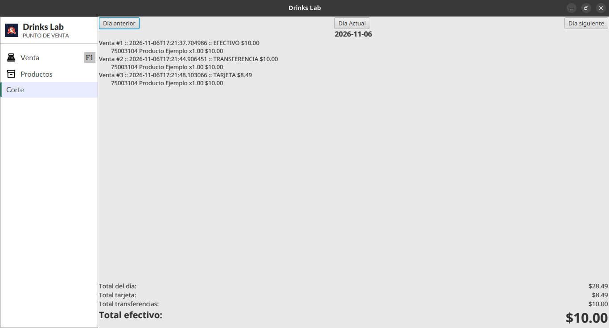
